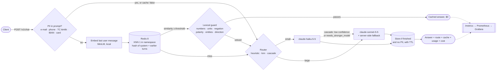

# llm-router

[](https://github.com/abdurrahmanyesilyurt/llm-router/actions/workflows/ci.yml)

**A gateway in front of Claude that decides, for every request, whether Claude needs to be called at all, and if so, which model.**
A semantic cache on Redis 8 vector search answers repeated questions for free, and a router sends easy prompts to
`claude-haiku-5-5` and hard ones to `claude-sonnet-5-5`. Prometheus and Grafana show what that does to cost per request,
hit rate and latency. The point of the repo is the measurement: every component comes with an evaluation that you can
re-run, and the README reports where the ideas fail as well as where they work.

| | |
|---|---|
| **API** | FastAPI: `POST /v1/chat`, `GET /health`, `GET /metrics` |
| **Claude** | Official `anthropic` SDK 2.x behind one injectable client. Server-side refusal fallback on Sonnet, structured output for the cascade, `effort` instead of sampling parameters |
| **Semantic cache** | Redis 8 Query Engine (built into `redis:8`), HNSW cosine index, KNN 1 per namespace, TTL, hit counters, PII skip, lexical guard against near-miss hits |
| **Embeddings** | Local `paraphrase-multilingual-MiniLM-L12-v2` via fastembed (384-d, CPU, free per call); deterministic hashing embedder for tests |
| **Routing** | `heuristic` (explainable TR+EN features), `knn` (vote over 86 labelled prompts), `cascade` (small model self-assesses with a JSON schema), `always-small`, `always-large` |
| **Metrics** | prometheus-client; Prometheus + Grafana with a provisioned dashboard (cost per request, cache hit rate, tier mix, p95 latency) |
| **Evaluation** | 87 dev + 32 held-out cache pairs, 122 labelled prompts (half Turkish), offline router eval, live quality-vs-cost harness with an Opus judge |
| **Quality** | 126 pytest tests (7 against a real Redis 8 via Testcontainers), ruff, GitHub Actions with a `redis:8` service container |

## Request flow



The embedding computed for the cache lookup is reused by the kNN router, so a request costs at most one local embedding
before any Claude call.

## Quick start

```bash
docker compose up -d redis prometheus grafana       # Redis on :56379, Prometheus :9090, Grafana :3000

python -m venv .venv && source .venv/bin/activate   # Windows: .venv\Scripts\activate
pip install -e ".[dev]"
export ANTHROPIC_API_KEY=...                         # or LLM_ROUTER_CLAUDE_BACKEND=stub to run without a key
llm-router serve --host 0.0.0.0                     # Prometheus also scrapes host.docker.internal:8000
```

Or run everything in containers: `docker compose --profile api up -d --build`. There is nothing to ingest. The kNN
examples ship in `eval/prompts.jsonl`, and the embedding model (~220 MB) downloads on first start.

```bash
curl -s localhost:8000/v1/chat -H 'Content-Type: application/json' -d '{
  "messages": [{"role": "user", "content": "python'"'"'da liste tersine nasıl çevrilir?"}]
}'
```

The response below is real output from the compose stack with `LLM_ROUTER_CLAUDE_BACKEND=stub`. The stub returns a
placeholder text and token counts estimated from the prompt, so the cost is illustrative and no model was called. The
first request had asked *"Python'da bir listeyi nasıl ters çeviririm?"*, so this paraphrase is served from the cache:

```json
{
  "text": "[stub claude-haiku-5-5] This is an offline placeholder answer, not a model output.",
  "model": "claude-haiku-5-5",
  "tier": "small",
  "route": {"strategy": "heuristic", "reason": "semantic cache hit (similarity 0.919 >= 0.88)", "score": null},
  "cache": {"hit": true, "similarity": 0.9192, "stored": false, "skipped": null, "hits": 1,
            "saved_cost_usd": 3.27e-05, "cached_by": "heuristic"},
  "usage": {"input_tokens": 0, "output_tokens": 0, "calls": []},
  "cost_usd": 0.0,
  "latency_ms": 8,
  "stop_reason": "end_turn",
  "refused": false
}
```

Request body: `{system?, messages: [{role, content}], max_tokens?, strategy?: "heuristic"|"knn"|"cascade"|"always-small"|"always-large", cache?: bool}`.
A miss reports the route (`"reason": "code(+1.0) debugging:beklenmedik(+1.0) reasoning:neden(+1.0) = 3.0 >= 1.5"`), one usage
entry per Claude call (two for an escalated cascade) and the summed `cost_usd`. A skipped cache says why
(`"skipped": "pii:email"`, `"disabled_by_request"`), and a vetoed hit names the rule (`"vetoed": "direction_differs:ankara"`).
`llm-router route "<prompt>"` explains a routing decision without calling Claude.

## Evaluation results

Everything below was produced by `llm-router eval-cache` and `llm-router eval-router`. Both run locally with the MiniLM
model, cost nothing, and write `eval/results/*.md|json`.

### Semantic cache: why a false hit is worse than a miss

A miss costs one Claude call, a fraction of a cent on Haiku. A false hit returns *another question's answer* with full
confidence: the train times *from* Ankara for a question about trains *to* Ankara, or the foods to eat for a question
about foods to avoid. Nothing downstream can detect it, because the answer is fluent and on topic. The threshold
is therefore chosen as **the highest recall at a false-hit rate of 0%**, not by F1.

`eval/cache_pairs.jsonl` holds 87 Turkish and English pairs: 43 paraphrases that should hit and 44 dangerous near-misses
(reversed direction, negation, *en yüksek* / *en düşük*, different numbers/dates/units, different entity, same text with
a different task, long prompts that differ only after the model's 128-token window).

| threshold | embedding only: precision | recall | false-hit rate | + guard: precision | recall | false-hit rate |
|---:|---:|---:|---:|---:|---:|---:|
| 0.80 | 0.549 | 0.907 | 72.7% | 0.975 | 0.907 | 2.3% |
| 0.84 | 0.544 | 0.861 | 70.5% | 0.974 | 0.861 | 2.3% |
| **0.88** | 0.533 | 0.744 | 63.6% | **1.000** | **0.744** | **0.0%** |
| 0.92 | 0.510 | 0.581 | 54.5% | 1.000 | 0.581 | 0.0% |
| 0.96 | 0.458 | 0.256 | 29.5% | 1.000 | 0.256 | 0.0% |
| 0.98 | 0.375 | 0.140 | 22.7% | 1.000 | 0.140 | 0.0% |

- **Similarity alone cannot be made safe.** Even at 0.98, 22.7% of the near-misses hit. "From my savings account to my
  checking account" and its reverse score 0.999, and the two long prompts that only differ after the embedding window
  score 0.997–0.998. Turkish direction (*İstanbul'dan Ankara'ya* / *Ankara'dan İstanbul'a*) scores 0.990.
- **With the lexical guard** (`guard.py`: numbers, units, negation including Turkish *-me/-siz* suffixes, polar pairs,
  named entities and their source/target role, English "X to Y" swaps, exact match beyond the embedding window),
  0.88 gives precision 1.000 and recall 0.744. That is the default `LLM_ROUTER_CACHE_THRESHOLD`. The guard wrongly
  vetoes one paraphrase (*özgeçmiş* vs *CV*), and that pair scores only 0.50 anyway.

**The held-out check.** I wrote the guard rules while looking at the 87 pairs above, so those numbers are optimistic.
`eval/cache_pairs_holdout.jsonl` (32 pairs) was written after the rules were frozen and evaluated once, without tuning:

| threshold | embedding only: precision | recall | false-hit rate | + guard: precision | recall | false-hit rate |
|---:|---:|---:|---:|---:|---:|---:|
| 0.88 | 0.455 | 0.667 | 70.6% | 0.625 | 0.667 | 35.3% |
| 0.92 | 0.357 | 0.333 | 52.9% | 0.556 | 0.333 | 23.5% |
| 0.98 | 0.143 | 0.067 | 35.3% | 0.333 | 0.067 | 11.8% |

The guard roughly halves the false hits on unseen data, but six of 17 near-misses still pass at 0.88. These pairs flip
on words no rule lists: *aç / tok karnına* (0.990), *Bitcoin'i Ethereum'a* (accusative vs dative, 0.988),
*enable / disable* (0.963), *kullanılabilir / kullanılmamalı* (0.945), *tablespoons / teaspoons* (0.916) and
*junior / senior* (0.904). Adding those words now would turn the holdout into a second dev set, so they stay as a
documented gap. The honest conclusion: **a bi-encoder plus rules is fine for FAQ-like traffic where near-misses are
rare, and unsafe where one word changes the answer.** For those namespaces, send `cache: false` or raise the threshold to
~1.0 (exact match). The next step is a verifier on hits (a cross-encoder, or a Haiku call that compares the two prompts),
measured on a fresh holdout.

Note that "false-hit rate" here is the share of *adversarial* near-miss pairs that hit. It is not the share of wrong
answers in production, which depends on how often such near-misses occur in real traffic.

### Router: label accuracy on the test split

`eval/prompts.jsonl` holds 122 prompts (61 Turkish, 61 English), each labelled `easy` (a small-model answer is
acceptable) or `hard`, with a one-line rationale. Easy categories are factual Q&A, rewriting, translation, extraction and
summarisation; hard ones are multi-step reasoning, debugging, design trade-offs, math word problems and legal/regulatory
analysis. Some prompts are deliberate traps: long summaries, "why" questions with textbook answers, trivial code edits,
short proofs. A stratified, hash-ordered split puts 86 prompts in train and 36 in test (18 easy, 18 hard).

| strategy | accuracy | TR | EN | recall (hard) | routed to small | hard → small | est. cost / 1k req | vs always-large |
|---|---:|---:|---:|---:|---:|---:|---:|---:|
| heuristic | 0.778 | 0.778 | 0.778 | 0.778 | 50.0% | 4 | $4.02 | 66% |
| knn | 0.750 | 0.667 | 0.833 | 0.944 | 30.6% | 1 | $5.07 | 83% |
| always-small | 0.500 | 0.500 | 0.500 | 0.000 | 100.0% | 18 | $0.31 | 5% |
| always-large | 0.500 | 0.500 | 0.500 | 1.000 | 0.0% | 0 | $6.13 | 100% |
| oracle (labels) | 1.000 | 1.000 | 1.000 | 1.000 | 50.0% | 0 | $4.65 | 76% |

Cost assumption (no API call): Haiku 5.5 vs Sonnet 5.5 list prices; input ≈ prompt characters / 3.5 + 20 tokens; output
300 tokens for easy and 900 for hard prompts, including adaptive thinking, assumed equal on both tiers. Real output
lengths differ by model and effort, which is what `eval-live` measures.

- **The heuristic overfits its author.** It scores 0.965 on the train split I used while writing the rules and 0.778
  on test. Its errors are keyword accidents in both directions. *"teslimat sürelerini kısaltmak"* fires the easy-task
  "shorten" marker on a hard logistics question, and a train-meeting word problem contains no math keyword. Going the
  other way, *"The contract starts on…"* fires the legal feature on an easy date-extraction prompt. The heuristic looks
  cheapest (66% of always-large), but part of that saving comes from answering 4 of 18 hard prompts with the small model.
- **kNN is the safer router, not the cheaper one.** Leave-one-out on the train split picked k=11 with no margin (LOO
  accuracy 0.930; at k=11 every margin > 0 did worse). With those settings kNN sends only one hard prompt to small, but
  it sends eight easy ones to large. The misrouted prompts' nearest neighbours are only 0.32–0.67 similar, because
  MiniLM clusters prompts by topic, not by difficulty. That costs 83% of always-large.
- **Even a perfect router only saves about a quarter** under this cost model (oracle: 76%), because hard prompts dominate
  the bill. Caching and the single-model-low-effort baseline below matter as much as routing.

### Live quality vs cost (needs an API key, not run yet)

`llm-router eval-live` answers each of the 36 test prompts three times: on Haiku (with the cascade's structured output,
so the cascade can be replayed offline), on Sonnet at its default effort, and on Sonnet at `effort: "low"`. Then
`claude-opus-5-5` judges pairwise whether the Haiku answer and the low-effort answer are acceptable compared with the
default Sonnet answer. Every strategy is scored offline from the stored outputs and their real token usage. The
dry run, which the CI also executes, prints the plan:

```text
$ llm-router eval-live --dry-run
eval-live plan: 36 test prompts -> 108 generation calls + 72 judge calls = 180 calls
upper bound on cost (every answer uses max_tokens=4096): $11.37
  small (claude-haiku-5-5): $0.08
  large (claude-sonnet-5-5): $1.48
  large_low (claude-sonnet-5-5, effort low): $1.48
  judge (claude-opus-5-5, 2 per prompt): $8.33
assumption: every answer hits max_tokens; input ≈ chars/3.5; list prices
```

> **Placeholder.** These cells stay empty until `llm-router eval-live --yes` is run with `ANTHROPIC_API_KEY` set. It
> writes `eval/results/live.md`.

| strategy | acceptable vs Sonnet (default effort) | answered by small | cost / 1k req | cost vs always-large |
|---|---:|---:|---:|---:|
| always-small | _pending_ | _pending_ | _pending_ | _pending_ |
| always-large | 100% by definition (reference) | 0% | _pending_ | 100% |
| large, effort low | _pending_ | 0% | _pending_ | _pending_ |
| heuristic | _pending_ | _pending_ | _pending_ | _pending_ |
| knn | _pending_ | _pending_ | _pending_ | _pending_ |
| cascade | _pending_ | _pending_ | _pending_ | _pending_ |

## Grafana

`docker compose up` provisions the Prometheus datasource and the **llm-router** dashboard (`deploy/grafana/dashboards`),
which is also Grafana's home page at <http://localhost:3000> (anonymous read-only). It shows cost per request, cache
hit rate (and the share vetoed by the guard), Claude spend vs spend saved by the cache, p95 latency overall and by cache
result, tier mix, requests per strategy → tier, cascade escalations by reason, cache skips by reason and tokens by model.
All 16 queries were checked against live Prometheus data from the stub-backed stack.

Metrics: `llm_router_requests_total{strategy,tier,cache}`, `llm_router_tokens_total{model,kind}`,
`llm_router_cost_usd_total{model}`, `llm_router_cache_saved_usd_total`, `llm_router_request_latency_seconds{cache}`,
`llm_router_cache_lookups_total{result}`, `llm_router_cache_hit_ratio`, `llm_router_cache_skipped_total{reason}`,
`llm_router_cache_guard_vetoes_total{reason}`, `llm_router_escalations_total{reason}`, `llm_router_errors_total{kind}`.

## Design decisions

**Per-namespace cache keys.** The answer to "summarise this" depends on the system prompt and on everything said
before. The cache key is the embedding of the *last* user message, but the lookup is restricted by a TAG filter to a
namespace: a SHA-256 of the system prompt plus every earlier turn (role and content). The same question under a different
persona, or later in a different conversation, cannot hit. Exact duplicates overwrite one entry (the key includes a hash
of the normalised prompt), and only finished answers are cached. Refusals and `max_tokens` truncations never are.

**Skipping personal data.** A cached answer is served to *other* callers whose prompt is merely similar, so a prompt that
carries an e-mail address, phone number, TC kimlik number (11 digits with both check digits validated), IBAN (TR by
shape, others by mod-97) or a Luhn-valid card number is neither looked up nor stored, and the response says why. A
false positive only costs a miss, so the patterns lean towards flagging. Checksums are used where the format alone
would also match ordinary numbers.

**Single model at low effort as the baseline.** Current models expose `output_config.effort`. Sonnet at `low` effort is
one model and one cache namespace, with no routing errors, so it is the baseline a router has to *beat* on quality per
dollar. Comparing only against "always Sonnet at default effort" would flatter every router. `eval-live` runs this arm
for that reason.

**kNN over a fine-tuned classifier.** With 86 labelled prompts, a fine-tuned classifier would mostly memorise them. kNN
over the same embeddings the cache already computes costs one matrix-vector product, needs no training step, explains
itself ("10/11 neighbours hard, nearest tr-math-03"), and improves by adding a line to a JSONL file. Its parameters were
picked by leave-one-out on the train split, and the test split was only scored.

**Cascade with structured output.** Haiku answers with a JSON schema (`answer`, `confidence`, `needs_stronger_model`) via
`output_config.format`, so escalation does not depend on parsing prose. The request escalates on low confidence, on the
flag, and on anything that is not a usable answer: refusal, truncation or invalid JSON. Both calls are billed and both
usages are returned. Self-reported confidence is a weak signal, which is why `eval-live` replays the cascade at any
threshold from stored outputs.

**Claude calls.** No `temperature`, `top_p` or `top_k` (current models reject them). Depth is controlled with `effort`.
`stop_reason == "refusal"` is checked before content, and only `text` blocks are read, because thinking blocks come back
with empty text. Sonnet and Opus go through `client.beta.messages.create(..., betas=["server-side-fallback-2026-07-01"],
fallbacks="default")`, while Haiku 5.5 has no server-side fallback and is called plainly. Defaults use `max_tokens=4096`,
because adaptive thinking counts towards it. Prices live in one table (`pricing.py`), and SDK errors map to HTTP 400 /
429 / 502 / 503. A broken Redis never fails a request; it only turns the cache off for that call.

**Redis 8 rather than Redis Stack.** `FT._LIST` works on the plain `redis:8` image (8.10.3 here). The Query Engine is part
of Redis Open Source 8, so `redis/redis-stack-server` is not needed.

## Limitations

- The labels, the cache pairs and the heuristic rules were written by one person. The test split and the cache holdout
  reduce, but do not remove, that bias, and both sets are small (36 and 32 items). Treat the numbers as a well-documented
  experiment, not a benchmark.
- The guard is English/Turkish word lists. It misses antonyms and case roles it does not list (see the holdout), and
  Turkish morphology is approximated with regular expressions.
- `paraphrase-multilingual-MiniLM-L12-v2` truncates at 128 tokens. Longer prompts only hit on an exact (normalised) match.
- Cache hits are tier-agnostic: an answer produced by Haiku can be served to a request that asked for `always-large`.
  Send `cache: false` when the tier matters more than the saving.
- The cost per 1k requests in the router table is a token *estimate*. Real costs, including thinking tokens and cascade
  double calls, come from `eval-live`, which has not been run.
- Streaming, tool use and multimodal content are out of scope. Messages are plain text.

## Project layout

```text
src/llm_router/   api · gateway · cache (Redis) · guard · pii · heuristic · knn · cascade · claude · pricing
                  embeddings · metrics · evaluation · live_eval · data · stub · cli
eval/             prompts.jsonl · cache_pairs.jsonl · cache_pairs_holdout.jsonl · results/
deploy/           prometheus.yml · Grafana provisioning and dashboard
tests/            unit tests with fakes; test_redis_cache.py runs against real Redis 8
```

Run the checks with `ruff check . && ruff format --check . && pytest -q`. The Redis tests use `REDIS_URL` if it is set,
otherwise a throwaway `redis:8` container, and they are skipped without Docker.

---

## Türkçe özet

**llm-router**, Claude'un önünde duran bir ağ geçidi. Her istekte önce Claude'u çağırmaya gerek olup olmadığına, gerekiyorsa
hangi modelin çağrılacağına karar veriyor. Redis 8 üzerindeki anlamsal önbellek, aynı soruyu başka kelimelerle soran
kullanıcıya ücretsiz cevap veriyor. Yönlendirici kolay istemleri `claude-haiku-5-5`'e, zorları `claude-sonnet-5-5`'e
gönderiyor. Prometheus ve Grafana ise istek başına maliyeti, önbellek isabet oranını ve gecikmeyi gösteriyor.

Ölçümlerden çıkanlar:

- Yalnızca gömme benzerliğine dayanan önbellek güvenli değil. *"İstanbul'dan Ankara'ya"* ile *"Ankara'dan İstanbul'a"*
  0,990 benzerlik alıyor ve 0,98 eşikte bile yakın-tuzakların %22,7'si isabet ediyor.
- Sözcüksel koruma (sayı, birim, olumsuzluk, zıt anlam, varlık ve yön kontrolleri) geliştirme setinde 0,88 eşikte yanlış
  isabeti %0'a indiriyor. Kurallar donduktan sonra yazılan 32 çiftlik ayrı sette ise yanlış isabet oranı %35,3 olarak
  ölçüldü. Kurallar görmediği kelimelerde (*aç/tok*, *enable/disable*) başarısız oluyor ve bu durum README'de olduğu
  gibi raporlanıyor.
- Test setinde sezgisel yönlendirici %77,8, kNN %75,0 doğruluk alıyor. Sezgisel olan daha ucuz görünüyor ama 18 zor
  istemin 4'ünü küçük modele gönderiyor. kNN yalnızca 1'ini gönderiyor, bu yüzden daha pahalı.
- Gerçek API ile kalite/maliyet ölçümü (`eval-live`) hazır ama API anahtarı olmadığı için çalıştırılmadı. İlgili
  tablo yer tutucu olarak bırakıldı.
